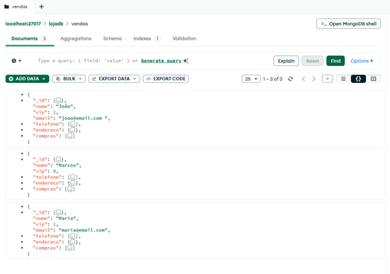
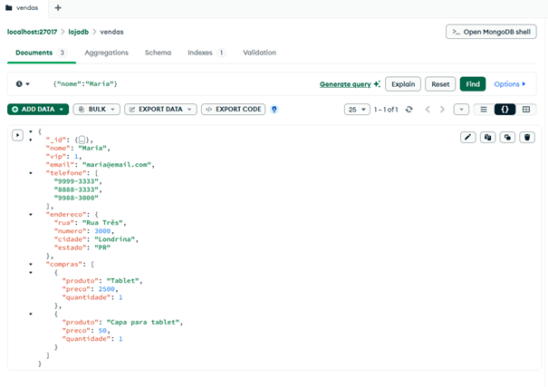
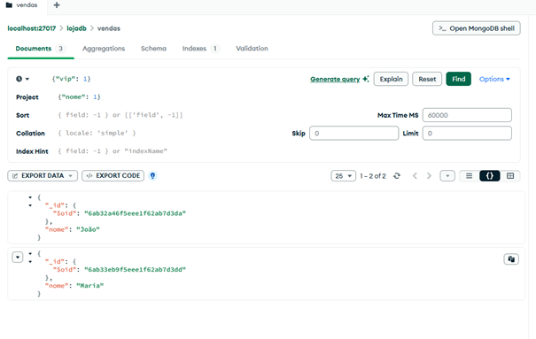
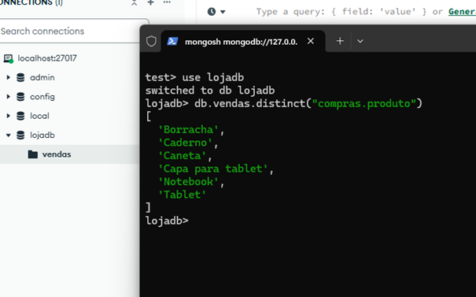

# MongoDB Loja NoSQL — Modelagem Orientada a Documentos

<div align="center">


</div>

Laboratório de Weslley Ribeiro para modelagem de clientes e compras em MongoDB, com carga JSON, consultas mongosh e inspeção pelo Compass. Os registros fornecidos são exemplos didáticos, não uma base de clientes de produção.

## Modelo documental

O banco lojadb contém a coleção vendas. Apesar do nome da coleção, a unidade de cada documento é um cliente com seus contatos, endereço e itens de compra incorporados. Não há uma entidade separada de pedido com data ou identificador de transação.

```text
lojadb.vendas
  documento de cliente
    nome: string
    vip: numero (0 ou 1)
    email: string opcional
    telefone: array de strings
    endereco: subdocumento
      rua, numero, complemento opcional, cidade, estado
    compras: array de subdocumentos
      produto, preco, quantidade
```

O arquivo JSON contém três documentos: João, Marcos e Maria. Marcos não possui email; somente João possui complemento. A ausência de um campo é diferente de armazenar null. Os telefones permanecem strings para preservar sua representação. MongoDB armazena documentos BSON; JSON é o formato de intercâmbio desta carga. O servidor gera _id quando o campo está ausente.

Não há validador de schema configurado. A flexibilidade permite campos opcionais, mas a aplicação deve manter consistência dos tipos. vip foi preservado como 0/1. Os preços são números didáticos; aplicações financeiras devem definir representação monetária e arredondamento, por exemplo com Decimal128 ou unidades inteiras mínimas.

## Relacional versus documental

| Aspecto | Possível modelo relacional normalizado | Modelo deste laboratório |
| --- | --- | --- |
| Cliente | Tabela de clientes | Documento de cliente |
| Telefones | Tabela relacionada ao cliente | Array telefone |
| Endereço | Colunas ou tabela relacionada | Subdocumento endereco |
| Compras | Tabelas de pedidos e itens | Array compras no cliente |
| Leitura conjunta | Pode exigir JOINs | Dados incorporados no documento |
| Atualização de produtos | Pode centralizar cadastro | Valores repetidos exigem política de atualização |
| Crescimento | Linhas relacionadas | Arrays precisam de limites e política de retenção |

A incorporação favorece o acesso conjunto neste cenário pequeno; não demonstra superioridade universal de desempenho ou escalabilidade. Operações de escrita em um único documento são atômicas. Arrays de histórico sem limite podem tornar o modelo inadequado, inclusive pelo limite de tamanho de documento BSON.

## Estrutura

```text
data/vendas_lojadb.json
scripts/operacoes_vendas.js
scripts/consultas_vendas.js
LICENSE
.gitignore
```

## Execução

Requisitos: MongoDB Community Server em execução, mongosh e, para inspeção visual, MongoDB Compass. Os comandos abaixo pressupõem servidor local em localhost:27017 e execução na raiz deste repositório. Não é necessário instalar dependências npm.

```sh
git clone https://github.com/Weslley-Ribeiro/mongodb-loja-nosql.git
cd mongodb-loja-nosql
mongosh "mongodb://localhost:27017" --file scripts/operacoes_vendas.js
```

O script seleciona explicitamente lojadb, lê o JSON e realiza insertMany apenas se vendas estiver vazia. Se houver documentos, interrompe a carga sem removê-los; esse bloqueio evita duplicações acidentais em uso sequencial. Não é um mecanismo de exclusão mútua para cargas concorrentes. A carga é destinada a um banco de laboratório.

Para repetir somente as consultas:

```sh
mongosh "mongodb://localhost:27017" --file scripts/consultas_vendas.js
```

No terminal interativo, a partir da mesma pasta:

```javascript
load('scripts/operacoes_vendas.js');
// Em uma base ja carregada:
load('scripts/consultas_vendas.js');
```

Como alternativa à carga pelo script, importar data/vendas_lojadb.json pelo Compass para lojadb.vendas ou usar MongoDB Database Tools:

```sh
mongoimport --uri="mongodb://localhost:27017" --db=lojadb --collection=vendas --file=data/vendas_lojadb.json --jsonArray
```

Escolher uma única forma de carga. A importação direta não executa a proteção do script e pode duplicar registros se repetida. Credenciais e URIs autenticadas não devem ser versionadas.

## Consultas e mapeamento de operadores

| Operação | Expressão | Semântica |
| --- | --- | --- |
| Inserção | insertMany(documentos) | Insere o lote |
| Leitura geral | find({}) | Seleciona todos os documentos |
| Igualdade | find({nome: 'Maria'}) | Filtra pelo nome |
| Filtro VIP | find({vip: 1}, {nome: 1, _id: 0}) | Seleciona VIPs e projeta somente nome |
| Array de compras | find({nome: 'Marcos'}, {compras: 1, _id: 0}) | Retorna as compras de Marcos |
| Valores distintos | distinct('compras.produto') | Extrai produtos únicos por notação de ponto |

find retorna cursor; os scripts usam toArray e printjson para tornar a saída explícita. distinct retorna os valores distintos do campo e não é um pipeline aggregate. A ordem de distinct e de consultas sem sort não é garantida. Não foram criados índices adicionais; filtros por nome não implicam uso automático de índice.

## Resultados esperados da carga fornecida

| Consulta | Resultado esperado |
| --- | --- |
| Todos | 3 documentos |
| nome Maria | 1 documento |
| vip 1 | Nomes João e Maria, sem _id |
| Compras de Marcos | Caderno (1), Caneta (5), Borracha (2) |
| Produtos distintos | 6 valores: Notebook, Caderno, Caneta, Borracha, Tablet, Capa para tablet |

Esses resultados decorrem do JSON fornecido e pressupõem uma coleção contendo somente essa carga; não representam registro de execução de testes nesta publicação.

## Interface e registros

<div align="center">
  <h3>Documentos e subdocumentos no Compass</h3>
  
  <h3>Filtro por Maria</h3>
  
  <h3>Projeção dos nomes VIP</h3>
  
  <h3>Produtos distintos no mongosh</h3>
  
</div>

## Licença

MIT, conforme LICENSE.
